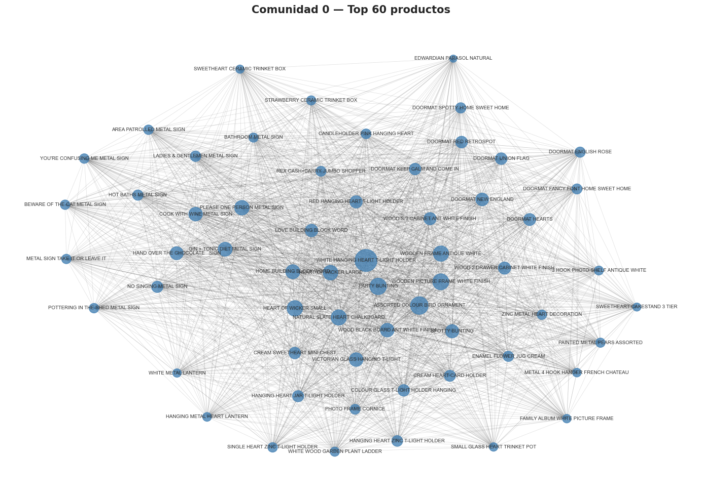
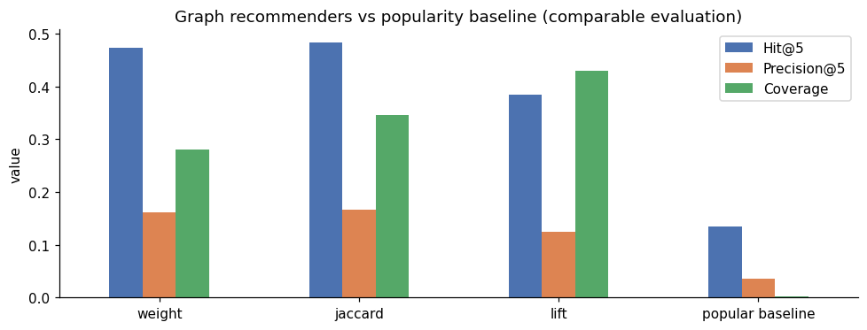

# Graph-Based Product Recommender

**NetworkX · Louvain & Leiden · Neo4j Graph Data Science · FastAPI · Docker**

An end-to-end graph-based recommendation system developed using real retail transaction data. The project explores two complementary graph technologies, **NetworkX and Neo4j**, to model product relationships, detect communities and generate personalised product recommendations.

It brings together graph analytics, recommendation algorithms, reproducible experimentation and backend development, demonstrating how data-driven models can be integrated into practical applications through a FastAPI-powered interactive store.

## Visual Overview



*Visualisation of product communities identified through graph analysis.*

## Project Overview

### The Problem

In e-commerce, recommending relevant products can improve product discovery and help customers find items that complement their purchases.

Traditional recommendation approaches often rely on user histories or product popularity. This project explores an alternative: **representing purchasing behaviour as a graph to discover relationships between products**.

The central question is:

> Given a product in a customer's shopping basket, which other products are most relevant to recommend?

### The Approach

The system models purchasing patterns using a weighted, undirected graph:

- **Nodes:** individual products.
- **Edges:** relationships between products purchased together.
- **Edge weights:** frequency of co-occurrence across transactions.
- **Communities:** groups of products with stronger purchasing relationships.
- **Recommendations:** candidate products ranked using graph-based similarity measures.

Community detection techniques help reveal product clusters, while different ranking strategies identify potentially relevant recommendations.

The project evaluates several approaches against a popularity-based baseline to understand their effectiveness.

## Two Complementary Implementations

The recommendation problem is explored using two graph technology stacks, each offering a different perspective on graph modelling and analysis.

| Capability | NetworkX / Python | Neo4j / Graph Data Science |
|---|---|---|
| Graph construction | Co-purchase relationships from transaction data | Product nodes and `BOUGHT_WITH` relationships |
| Community detection | Louvain and Leiden | GDS Louvain |
| Recommendation methods | Co-occurrence weight, Jaccard and Lift | Cypher-based recommendation queries |
| Evaluation | Hit@5, Precision@5, Recall@5 and Coverage | Community comparison using ARI and NMI |
| Main focus | Algorithm development and experimentation | Graph database modelling and querying |

### 1. NetworkX and Leiden

The Python implementation focuses on analysing product relationships and evaluating recommendation strategies.

It covers:

- Transaction preprocessing and graph construction.
- Weighted co-purchase relationships.
- Louvain and Leiden community detection.
- Recommendation ranking using co-occurrence weight, Jaccard similarity and Lift.
- Offline evaluation with held-out transactions.
- Comparison against a popularity-based baseline.

### 2. Neo4j and Graph Data Science

The Neo4j implementation explores the same graph problem using a graph database.

It includes:

- Graph modelling with product nodes and relationships.
- Data loading into Neo4j.
- Community detection using Graph Data Science.
- Recommendation queries written in Cypher.
- Comparison of community structures across implementations.

Together, both approaches provide experience with in-memory graph analysis and graph database technologies.

### Notebooks

The project includes two notebooks:

- **`01_exploratory_networkx.ipynb`** — Exploratory analysis of product relationships, graph structures and recommendation strategies using NetworkX.
- **`02_networkx_leiden_neo4j.ipynb`** — Extended implementation covering graph construction, community detection, recommendation evaluation and integration with Neo4j.

The exploratory notebook uses product descriptions as nodes to investigate graph behaviour. The quantitative recommendation results presented below come from the extended implementation.

## Experimental Results

The recommendation algorithms were evaluated using the **Online Retail dataset from the UCI Machine Learning Repository**.

### Dataset and Evaluation

| Property | Value |
|---|---|
| Original dataset | 541,909 transaction records |
| Products in the pruned training graph | 2,560 |
| Graph edges | 104,235 |
| Evaluated test baskets | 3,633 |
| Evaluation | Invoice-level holdout |
| Baseline | Product popularity |

All recommendation methods were evaluated using the same eligible test baskets and product catalogue.

The evaluation excludes the input product from the recommendations and counts empty recommendation lists as unsuccessful predictions.

### Recommendation Performance

| Method | Hit@5 | Precision@5 | Recall@5 | Coverage |
|---|---:|---:|---:|---:|
| Co-occurrence weight | 0.474 | 0.162 | 0.076 | 0.281 |
| **Jaccard similarity** | **0.484** | **0.166** | **0.079** | 0.346 |
| Lift | 0.384 | 0.125 | 0.067 | **0.430** |
| Popularity baseline | 0.135 | 0.036 | 0.006 | 0.002 |



### Key Findings

**Jaccard similarity achieved the highest Hit@5 (0.484)**, compared with 0.135 for the popularity baseline.

This represents approximately **3.6 times the baseline Hit@5** under the same evaluation protocol.

Other observations include:

- Co-occurrence weight achieved competitive recommendation accuracy.
- Jaccard provided the strongest Hit@5, Precision@5 and Recall@5 among the evaluated methods.
- Lift achieved the highest catalogue coverage, suggesting a different balance between recommendation relevance and product diversity.
- Graph-based methods consistently outperformed the popularity baseline in this offline experiment.

These findings illustrate the potential of graph-based approaches for identifying meaningful relationships between products.

## Community Detection Analysis

Community detection was performed on the product co-purchase graph using Louvain and Leiden.

| Method | Communities | Modularity (Q) |
|---|---:|---:|
| NetworkX Louvain | 40 | 0.301 |
| Leiden | 37 | 0.301 |
| Leiden refinement of 8 largest Louvain communities | 105 | 0.230 |

The refinement experiment explores finer-grained product communities, providing an additional perspective on the graph's internal structure.

### NetworkX vs Neo4j

A separate execution compared Louvain community detection across NetworkX and Neo4j Graph Data Science.

| Metric | Result |
|---|---:|
| NetworkX modularity | 0.301 |
| Neo4j GDS modularity | 0.302 |
| Adjusted Rand Index (ARI) | 0.681 |
| Normalised Mutual Information (NMI) | 0.700 |
| Shared products | 2,560 |

The results indicate substantial similarity between the community structures obtained from both implementations, although the partitions are not identical.

These Neo4j results come from a separate execution. The current NetworkX recommendation benchmark was reproduced independently; reproducing the Neo4j comparison requires a running Neo4j instance.

## Evaluation Methodology and Limitations

The evaluation follows a consistent offline protocol:

- Training and test sets are separated at invoice level.
- All methods use the same eligible test baskets.
- The input product is excluded from recommendation results.
- Empty recommendation lists count as misses.
- The popularity baseline uses the same evaluable catalogue.
- Only products represented in the training graph can be recommended.

Of the 3,650 held-out baskets, 3,633 met the evaluation criteria.

The experiment uses a random invoice-level split rather than a chronological split. Consequently, the results measure offline recommendation performance and should not be interpreted as evidence of production performance or improvements in customer conversion.

The notebooks provide the experimental implementation, intermediate analysis and evaluation outputs.

## Technology Stack

| Area | Technologies |
|---|---|
| Programming | Python |
| Data processing | Pandas, NumPy |
| Graph analytics | NetworkX, igraph, Leidenalg |
| Machine Learning & Evaluation | Scikit-learn, graph algorithms, ranking metrics |
| Graph databases | Neo4j, Graph Data Science, Cypher |
| Backend | FastAPI, Uvicorn |
| Frontend | HTML, CSS, JavaScript |
| Development & Deployment | Docker, Docker Compose |
| Experimentation | Jupyter Notebook |
| Testing | pytest |

## Interactive Recommendation Demo

The project includes a lightweight e-commerce demonstration that allows users to explore the recommendation engine through a browser.

The application uses **FastAPI** to expose recommendation functionality through HTTP endpoints and a web interface.

### Features

- Browse and search the product catalogue.
- Retrieve popular products.
- Generate recommendations from a selected product.
- Generate recommendations from multiple products in a shopping basket.
- Load recommendation models stored in JSON or compressed JSON format.
- Run a demonstration using synthetic transactions without configuring Neo4j.

### API Endpoints

| Endpoint | Description |
|---|---|
| `GET /api/catalogo` | Search and browse products |
| `GET /api/virales` | Retrieve popular products |
| `GET /api/recomendar` | Recommend products from a seed product |
| `GET /api/recomendar_carrito` | Generate recommendations for a basket |
| `GET /health` | Application health check |

Example requests:

```http
GET /api/catalogo?q=mug&page=1&size=24
GET /api/virales?n=10
GET /api/recomendar?code=A101&k=5
GET /api/recomendar_carrito?codes=A101,A102&k=5
GET /health
```

## Quick Start

The demonstration can be executed locally without Neo4j.

### 1. Clone the Repository

```bash
git clone https://github.com/cristinamaragu/graph-based-product-recommender.git
cd graph-based-product-recommender
```

### 2. Create a Virtual Environment

```bash
python -m venv .venv
```

Activate the environment.

On Windows:

```bash
.venv\Scripts\activate
```

On Linux or macOS:

```bash
source .venv/bin/activate
```

### 3. Install Dependencies

```bash
pip install -r requirements-dev.txt
```

### 4. Generate the Sample Model

```bash
python scripts/build_sample_model.py
```

### 5. Start the API

```bash
uvicorn api:app --reload
```

Open the application at:

**http://localhost:8000**

The sample model is generated from synthetic transactions and is intended to demonstrate the application's functionality independently of the full dataset.

### Alternative: Docker

The demonstration can also be started using Docker Compose:

```bash
docker compose up --build api
```

The API container uses a lightweight dependency configuration. The complete graph analysis environment is provided separately.

## Reproducing the Full Experiment

The full recommendation experiment can be reproduced using the public UCI dataset.

### 1. Download the Dataset

Download **Online Retail** from the UCI Machine Learning Repository:

https://archive.ics.uci.edu/dataset/352/online+retail

Save the file at:

```text
data/Online_Retail.xlsx
```

Additional information is available in `data/README.md`.

### 2. Install Analysis Dependencies

```bash
pip install -r requirements.txt
```

### 3. Run the Analysis

Open the following notebook in Jupyter:

```text
notebooks/02_networkx_leiden_neo4j.ipynb
```

The notebook contains the data preparation, graph construction, community detection, recommendation algorithms and evaluation pipeline.

The NetworkX and Leiden experiments can be executed without a Neo4j server, provided the required Python packages are installed.

### 4. Optional: Neo4j Analysis

The Neo4j implementation requires a running database.

Copy the environment configuration:

```bash
cp .env.example .env
```

Set your own `NEO4J_PASSWORD` and `JUPYTER_TOKEN` in the `.env` file.

Start the analysis services:

```bash
docker compose --profile analysis up --build neo4j notebook
```

Available interfaces:

- **Neo4j Browser:** http://localhost:7474
- **Jupyter:** http://localhost:8888

**Important:** The Neo4j notebook contains a database reset operation using `MATCH (n) DETACH DELETE n`. Run it only against a dedicated database containing disposable experiment data.

### 5. Export the Recommendation Model

The evaluated notebook includes an export step that creates a model artifact under:

```text
artifacts/
```

The FastAPI application can load the exported model by setting:

```bash
MODEL_PATH=artifacts/model.json.gz
```

This allows the application to serve recommendations derived from the UCI dataset instead of the synthetic example.

The API uses JSON-based model artifacts rather than arbitrary Python pickle deserialization.

## Project Structure

```text
graph-based-product-recommender/
|
|-- api.py
|-- web/
|   |-- index.html
|
|-- notebooks/
|   |-- 01_exploratory_networkx.ipynb
|   |-- 02_networkx_leiden_neo4j.ipynb
|
|-- scripts/
|   |-- build_sample_model.py
|
|-- examples/
|   |-- sample_model.json
|
|-- data/
|   |-- README.md
|   |-- sample_transactions.csv
|
|-- assets/
|   |-- networkx_community_visualization.png
|   |-- offline_metrics_comparable.png
|
|-- tests/
|
|-- Dockerfile
|-- Dockerfile.analysis
|-- docker-compose.yml
|-- requirements.txt
|-- requirements-api.txt
|-- requirements-dev.txt
|-- .env.example
|-- README.md
```

## Data, Reproducibility & Deployment

The project combines reproducible experimentation with a functional application prototype.

- **Public dataset:** The experiments use the *Online Retail* dataset from the UCI Machine Learning Repository.
- **Reproducibility:** The notebooks document preprocessing, graph construction, recommendation algorithms and comparative evaluation.
- **Demo data:** Synthetic transactions allow the application to run independently of the original dataset.
- **Model portability:** JSON and compressed JSON artifacts separate the evaluated recommendation model from the application.
- **Deployment:** The FastAPI demonstration illustrates how graph-based recommendations can be exposed through an application interface. Production deployment would require additional authentication, rate limiting, security controls and monitoring.

The architecture separates data analysis, model evaluation and application serving, making it easier to extend or adapt individual components.

## Dataset Reference

Chen, D. (2015). *Online Retail*. UCI Machine Learning Repository.

https://doi.org/10.24432/C5BW33

Dataset licensed under CC BY 4.0.
